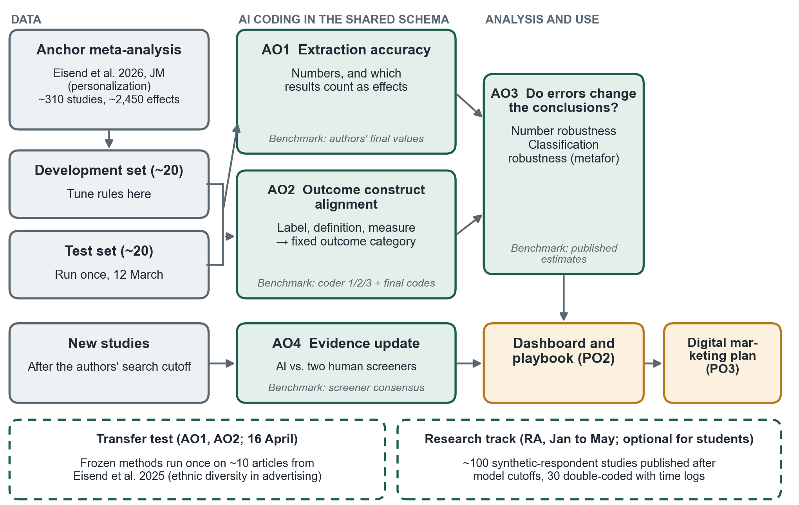
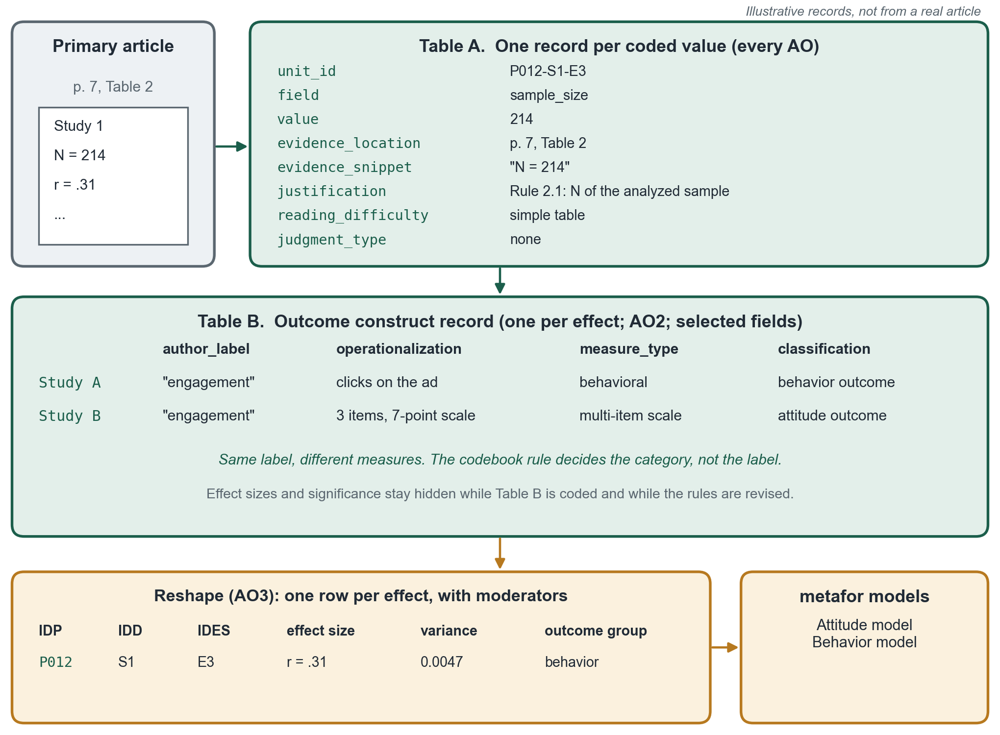

<!-- Rewritten 18 Oct 2026 for the CALIPER meta-analysis direction (Lin, 14 Oct 2026 document). Each AO owner should revise their own 1.3.x, 2.7.x and 3.2.10 subsections before 22 Oct. -->

# TITLE PAGE {.unnumbered}

::: title-page
**AI-ASSISTED EVIDENCE SYNTHESIS FOR MARKETING DECISIONS: VALIDATING A CALIPER META-ANALYSIS OF PERSONALIZATION AND A CONSULTANT DECISION DASHBOARD FOR TBFI**

A Project Presented to the Faculty of the\
College of Business Administration\
California State Polytechnic University, Pomona

In Partial Fulfillment of the Requirements for the Degree\
Master of Science in Digital Marketing

By\
Yushan Huang\
Simran Kaur\
Gabriela Raygoza Quintero\
Alondra Rodriguez

2027
:::

# SIGNATURE PAGE {.unnumbered}

\[To be completed in the summer semester using the front matters template.\]

# ACKNOWLEDGMENTS PAGE {.unnumbered}

\[Optional. To be completed in the summer semester.\]

# ABSTRACT {.unnumbered}

\[To be completed in the summer semester (250 words maximum, including Purpose, Design/methodology/approach, Findings, Originality/Value, Practical implications, and up to six keywords).\]

# SUMMARY OF INDIVIDUAL CONTRIBUTION {.unnumbered}

**Yushan Huang**

\[75–100 word summary, to be completed in the summer semester.\]

**Simran Kaur**

\[75–100 word summary, to be completed in the summer semester.\]

**Gabriela Raygoza Quintero**

\[75–100 word summary, to be completed in the summer semester.\]

**Alondra Rodriguez**

\[75–100 word summary, to be completed in the summer semester.\]

# TABLE OF CONTENTS {.unnumbered}

The table of contents appears in the sidebar on the right.

# CHAPTER 1: INTRODUCTION {#sec-ch1-introduction}

## Background and Business Problem(s) {#sec-background}

Small and mid-sized businesses in the San Gabriel Valley (SGV) make marketing decisions every week. Should a restaurant personalize its emails? Will a targeted Instagram ad that uses a customer's location feel helpful or creepy? Most of these businesses cannot pay for a custom study, so they rely on intuition or on whatever a platform vendor tells them. A large body of published consumer research already answers many of these questions, but it is scattered across hundreds of articles, written for academics, and rarely summarized in a form a business owner can use.

A meta-analysis solves part of this problem. It pulls the results of many studies together and estimates how large an effect is on average, how much it varies, and what it depends on [@grewal2018; @borenstein2021]. Personalization is a good example. Some studies find that personalized messages raise purchase intention and clicks, while others find that they trigger privacy concerns and ad avoidance, a tension known as the personalization paradox [@aguirre2015; @bleier2015]. A recent meta-analysis in the *Journal of Marketing* combined 1,536 effect sizes from 290 studies and found that personalization mostly works, that its negative effects are small, and that it works best when it draws on data closely tied to a consumer's self-concept, such as interests and values [@eisend2026].

The catch is cost and speed. A meta-analysis takes trained coders months to read every article, pull out sample sizes and test statistics, and decide which outcomes count as attitudes, behaviors, or privacy reactions. Human coders make mistakes too; studies of published meta-analyses find extraction errors in a meaningful share of values [@gotzsche2007; @mathes2017]. Large language models (LLMs) can now screen articles and extract data [@khraisha2024; @gartlehner2024] and label text as well as or better than crowd workers [@gilardi2023]. But an AI coder is only useful if we know how accurate it is, and agreement between two AI coders does not prove that either one is right.

Our client is the Tarkington Business Futures Institute (TBFI) at Cal Poly Pomona's College of Business Administration [@cpp2026; @tbfi2026]. TBFI wants to give local businesses research-backed advice quickly and at low cost. To do that, it needs a way to synthesize published evidence that is fast enough to keep up with new studies and trustworthy enough to put in front of a client. This project builds and tests that workflow. We use CALIPER, a protocol in which two AI coders from different model families code the same material and their disagreements are used to improve the coding rules; a rule change is kept only if it makes the coding more accurate against human coding [@caliper2026]. CALIPER is also available as a no-code web application [@caliperapp2026]. The anchor is the personalization meta-analysis by @eisend2026, whose authors posted each human coder's values on Harvard Dataverse [@eisend2026data]. That gives every part of the project a human benchmark without any new data collection.

**Why this matters beyond TBFI.** TBFI first came to this project interested in synthetic respondents, and the market for them is growing. Vendors now sell AI personas and simulated markets that answer business questions. Where these vendors report validation, they usually test whether a persona repeats one person's held-out answers. Published comparisons of synthetic and human respondents show that LLMs can reproduce many aggregate patterns but can also be overconfident, too uniform, or biased for some groups [@argyle2023; @aher2023; @horton2023; @brand2023; @li2024; @bisbee2024; @wang2026]. No public benchmark tests whether a simulated panel reproduces the *effects* that real experiments find, for example how much personalization changes attitudes and behavior. A meta-analysis coded with CALIPER can provide that benchmark: effect sizes and moderators from published experiments, each value tied to a page in the source article and checked against human coders. Its limit is that a meta-analysis averages published and mostly lab studies, so it calibrates effects rather than individual answers.

## Project Objectives (PO's) {#sec-po}

The project has three business objectives.

- **PO1. AI-assisted evidence synthesis**: Develop and validate an AI-assisted meta-analysis workflow (CALIPER) that extracts and codes published consumer research about as accurately as trained human coders, so that TBFI can answer business questions with research evidence quickly.
- **PO2. TBFI consultant decision support**: Turn the validated evidence into a dashboard and a consultant playbook on personalization. The playbook says which personalization tactics work, for whom, and in which channels, and where the evidence is too thin to advise.
- **PO3. TBFI promotion and business intake (spring and summer)**: Develop and run a data-informed digital marketing plan that uses the dashboard and playbook as content to raise TBFI's visibility and qualified business intake among SGV businesses, measured with GA4 and UTM-tagged campaigns. This is the team's Chapter 5 plan.

## Analytics Objectives {#sec-ao}

Each AO has one owner, one primary PO, a human benchmark, and a measurable result. All four AO owners learn the full workflow on the same development articles, but each answers a different question. @tbl-ao-po lists every AO next to the project objective it supports.

| AO and Owner | Analytics Objective | Project Objective Supported |
|:-----------------|:--------------------------|:--------------------------|
| AO1. Effect-Size Extraction Accuracy (Alondra Rodriguez) | Measure how accurately AI extracts the numbers a meta-analysis needs (sample sizes, effect sizes, test statistics, and which results count as effects), comparing single-pass extraction with evidence-linked extraction. | PO1: Develop and validate an AI-assisted meta-analysis workflow. |
| AO2. Outcome Construct Alignment with CALIPER (Gabriela Raygoza Quintero) | Test whether CALIPER rule revision lets AI coders assign each study's outcome to the meta-analysis's outcome categories as accurately as human coders. | PO1: Develop and validate an AI-assisted meta-analysis workflow. |
| AO3. Do Coding Errors Change the Conclusions? (Yushan Huang) | Estimate how much the pooled effects, heterogeneity, and moderator results change when AI-extracted numbers and AI outcome classifications replace the human values. | PO1 (feeds PO2): Validate the workflow and identify which findings are robust enough to advise on. |
| AO4. Evidence Update and Decision Dashboard (Simran Kaur) | Test whether AI-assisted screening finds personalization studies published after the meta-analysis's search cutoff as completely as two human screeners, and whether TBFI consultants can use the resulting dashboard to answer questions correctly. | PO2: Turn validated evidence into a dashboard and consultant playbook. |

: Summary of Analytics Objectives and the Project Objectives They Support

@fig-po-ao shows the study design. Development articles tune the AO1 and AO2 methods, the test set is run once, and AO3 tests whether coding errors change the conclusions. AO4 adds studies published after the authors' search cutoff and feeds the dashboard and playbook (PO2), which the digital marketing plan (PO3) then promotes. The dashed boxes are the spring transfer test and the optional RA-led research track.

{#fig-po-ao width="100%"}

### AO1. Effect-Size Extraction Accuracy (Alondra Rodriguez) {#sec-ao1}

- **PO1**: Develop and validate an AI-assisted meta-analysis workflow that codes published consumer research about as accurately as trained human coders.
- **AO1**: How accurately can AI extract the numbers a meta-analysis needs from primary articles (sample sizes, effect sizes, and test statistics), plus the judgment about which results count as effects?
  - **Data Source**: Full texts of the primary articles in @eisend2026 and the authors' final coded values on Harvard Dataverse [@eisend2026data].

#### How to Address AO1

Two AI workflows run on the same development articles. In single-pass extraction, one model reads the article and returns the values. In evidence-linked extraction, the model must quote the page and table for every value, and a second model checks that the quote supports it. Each value is compared with the authors' final coded value. Results are broken down by field type, separating plain numbers from judgment calls such as which effect to code, and errors are sorted into reading errors (the right number was misread) and scope errors (the wrong result was treated as an effect).

#### How AO1 Will Help Achieve PO1

AO1 shows which parts of extraction AI can do reliably and which still need a person. Its output is an accuracy table by field type, an error taxonomy, and a verification rule TBFI can adopt. The extracted numbers also feed AO3.

### AO2. Outcome Construct Alignment with CALIPER (Gabriela Raygoza Quintero) {#sec-ao2}

- **PO1**: Develop and validate an AI-assisted meta-analysis workflow that codes published consumer research about as accurately as trained human coders.
- **AO2**: Primary studies often give the same construct different definitions and measures, or give different names to the same thing. Can CALIPER revise the codebook rules so that AI coders assign each study's outcome (dependent variable) to the meta-analysis's outcome categories as accurately as the human coders?
  - **Data Source**: The outcome wording, coder 1, coder 2, and final outcome codes in the Dataverse file [@eisend2026data]; the outcome definitions in Table 3 and moderator rules in Table 5 of @eisend2026; and the primary articles.

#### How to Address AO2

The meta-analysts' outcome categories and their definitions stay fixed. Only the rules that map a study's label, definition, and measure to a category are revised. Four conditions are compared: (0) the author's outcome wording plus the codebook, with no article text; (a) category names only, with the article; (b) one AI coder with the article and the codebook; and (c) two AI coders from different model families plus CALIPER rule revision. Comparing (0) with (b) shows how much reading the actual measure adds beyond its name. Coders never see effect sizes, significance, or whether hypotheses were supported.

#### How AO2 Will Help Achieve PO1

AO2 produces a revised codebook with a log of every rule change, a validity table by condition, and a crosswalk from author labels to categories. These show whether AI classification can be trusted and where human review is still needed. The AI classifications also feed AO3.

### AO3. Do Coding Errors Change the Conclusions? (Yushan Huang) {#sec-ao3}

- **PO1 (feeds PO2)**: Validate the workflow and identify which personalization findings are robust enough for TBFI to advise on.
- **AO3**: How much do the meta-analysis's pooled effects, heterogeneity, and moderator results change when AI-extracted numbers replace the human values, and when outcomes are classified differently?
  - **Data Source**: The Dataverse data and the authors' R scripts [@eisend2026data], AO1 extracted values, and AO2 classifications.

#### How to Address AO3

The analysis runs in three steps. First, the published results are reproduced with the authors' data and scripts; this must match before anything else starts. Second, the models are re-estimated with the effect sizes and sample sizes extracted in AO1 (number robustness). Third, every effect size is held at its published value and only the outcome classification changes, using four versions: coder 1, coder 2, AI before alignment, and AI after alignment (classification robustness). Each estimate is compared with the published one in standard-error units, and sign and significance flips are counted.

#### How AO3 Will Help Achieve PO1 and PO2

AO3 answers the question a manager would ask: do AI coding errors change the advice? Its one-page brief, "Which personalization findings are fragile and which hold," decides which results go on the dashboard as firm guidance and which carry a caution.

### AO4. Evidence Update and Decision Dashboard (Simran Kaur) {#sec-ao4}

- **PO2**: Turn the validated evidence into a dashboard and a consultant playbook on personalization.
- **AO4**: Can an AI-assisted search and screening workflow find personalization studies published after the meta-analysis's search cutoff about as completely as two human screeners? Can TBFI consultants use the resulting dashboard to answer questions correctly?
  - **Data Source**: Database search results (EBSCO, ScienceDirect, and ProQuest Dissertations and Theses, with Google Scholar for citation searching) for studies published after the search period of @eisend2026; screening decisions from two independent human screeners; the validated results from AO1 to AO3; and a dashboard walkthrough with TBFI staff.

#### How to Address AO4

The search repeats the keyword strategy of @eisend2026 for the period after its cutoff and logs every database, query, date, and hit count. An AI screener then makes include or exclude decisions on titles and abstracts, and two human screeners independently screen the same records. Agreement between the humans is measured with Cohen's kappa, and the AI's decisions are scored for recall and precision against the human consensus. Recall matters most, because a study the screener misses never reaches the evidence base. Eligible new studies are added to an updated evidence map and reported in a PRISMA flow diagram [@page2021].

The validated evidence then goes into a dashboard (Looker Studio or Streamlit) and a draft consultant playbook. To test whether the dashboard works, TBFI staff answer a set of realistic client questions using it, such as "Does personalizing an email with the customer's first name raise click-through?" Their answers are scored against an answer key built from the AO3 results.

#### How AO4 Will Help Achieve PO2

AO4 turns the research into something a TBFI consultant can use in a client meeting. The screening test shows whether TBFI can keep the evidence current without paying for a full human review every year, and the walkthrough shows whether the dashboard leads consultants to the right answer. The dashboard and playbook are also the main content for the PO3 marketing plan.

## Significance of the Topic {#sec-significance}

This project matters to four groups. SGV businesses get practical guidance on personalization, a tactic they already use in email, social ads, and websites, based on hundreds of published studies rather than on vendor claims. TBFI gets a tested workflow for turning research into advice, a dashboard and playbook it can show prospective clients, and a way to keep that evidence current as new studies appear. The research field gets a direct test of AI coding against posted human coding at every step, from reading a number off a table to the final pooled estimate, along with a benchmark that synthetic-respondent tools could later be held to. For our team, the project builds skills employers want: evaluating AI output against a ground truth, working with secondary data in R, designing dashboards for decision makers, and running a measured digital campaign.

# CHAPTER 2: BACKGROUND AND ANALYTICS OBJECTIVES {#sec-ch2}

## Client (Company) Background

### Company Mission/Vision

\[To be completed.\]

### Core Competencies

\[To be completed.\]

### Value Propositions

\[To be completed.\]

### Business Objectives

\[To be completed.\]

## Description of the Client's Current Marketing Program

### Marketing Team and Expertise

\[To be completed.\]

### Current Target Market

\[To be completed.\]

### Current Positioning and Perceptual Map

\[To be completed.\]

### Current Product/Services

\[To be completed.\]

### Current Pricing

\[To be completed.\]

### Current Marketing Channels

\[To be completed.\]

### Current Integrated Marketing Communications

\[To be completed.\]

## Description of the Company's Current Digital Marketing Practices

### Brand Persona

\[To be completed.\]

### Digital Marketing Channels/Medium

\[To be completed.\]

### Other Digital Marketing Channels and Tactics

\[To be completed.\]

### Allocation of Resources to Customer-Influence Efforts

\[To be completed.\]

### Analytics Infrastructure

\[To be completed.\]

## Competitive Analysis

### Industry Size

\[To be completed.\]

### Industry Outlook

\[To be completed.\]

### Key Competitors and Their Digital Marketing Strategies

\[To be completed.\]

## Customer Analysis

### Segments and Their Brief Justification

\[To be completed.\]

### Segment Analysis

\[To be completed.\]

## SWOT Analysis

### Strengths

\[To be completed.\]

### Weaknesses

\[To be completed.\]

### Opportunities

\[To be completed.\]

### Threats

\[To be completed.\]

### Summary: SWOT Quadrants

\[To be completed.\]

## Investigation of Currently Available Research Framework/Model {#sec-lit-review}

This section reviews the research frameworks, models, and evidence relevant to each analytics objective. For each AO, it asks whether established research already answers the question, whether that information is adequate for TBFI, what additional analysis is needed, and whether the AO should be kept, revised, or narrowed. The literature on synthetic and human respondents collected in the 16 October search log supports the motivation in @sec-background and is not repeated here.

### AO1. Effect-Size Extraction Accuracy (Alondra Rodriguez)

**Analytics Objective:** Measure how accurately AI extracts the numbers a meta-analysis needs from primary articles, comparing single-pass extraction with evidence-linked extraction.

#### Existence of Well-established Models

Meta-analysis has well-established rules for turning reported statistics into a common effect size. Means, *t* values, and regression coefficients are converted into correlations or standardized mean differences using standard formulas [@borenstein2021], and @eisend2026 follow these guidelines when converting results into correlations. Standard practice also calls for double extraction by two people, because single extraction misses or misreads values [@mathes2017]. Even in published meta-analyses, a review of standardized-mean-difference extractions found errors serious enough to change conclusions in some cases [@gotzsche2007].

#### Adequateness of Gathered Information

Early tests show that LLMs can extract study data, but accuracy varies with the field. In a proof-of-concept study, an LLM extracted most data elements correctly but struggled with more complex values [@gartlehner2024], and GPT-4 performed well on some extraction tasks and poorly on others [@khraisha2024]. These studies come mostly from medicine, score extraction against a single human reference, and rarely separate reading errors from decisions about which result counts as an effect. None test the kind of consumer-research articles TBFI would rely on.

#### Need for Additional Analysis

AO1 fills that gap by scoring AI extraction field by field against the posted values of a marketing meta-analysis, by separating plain numbers from judgment calls, and by testing whether requiring a page-level quote and a second-model check reduces unsupported values.

#### Assessment and Affirmation of Analytics Objectives

AO1 is affirmed as written. It compares single-pass and evidence-linked extraction on the development articles, reports field-level accuracy, numeric match within a set tolerance (for example, an absolute difference in *r* of .01 or less), missed-effect and extra-effect rates, and the unsupported-value rate, and ends with a verification rule TBFI can adopt.

### AO2. Outcome Construct Alignment with CALIPER (Gabriela Raygoza Quintero)

**Analytics Objective:** Test whether CALIPER rule revision lets AI coders assign each study's outcome to the meta-analysis's outcome categories as accurately as human coders.

#### Existence of Well-established Models

Content analysis treats a codebook as a measurement instrument. Coders apply written rules, and reliability is checked with agreement statistics such as Cohen's kappa and Krippendorff's alpha [@cohen1960; @krippendorff2018]. @eisend2026 follow this model: two coders independently assigned every outcome to the categories defined in their Table 3 (Cohen's kappa = .857), and a third coder resolved disagreements. CALIPER extends the same logic to LLM coders. It keeps the construct definition fixed, uses disagreements between models from different families to write better operational rules, and keeps a revision only if it improves accuracy against reference labels on a development sample [@caliper2026].

#### Adequateness of Gathered Information

LLMs can label text at or above crowd-worker quality [@gilardi2023], and CALIPER improved out-of-sample accuracy for the constructs it refined [@caliper2026]. However, CALIPER has been tested on constructs expressed in text such as reviews and service conversations, not on mapping a study's outcome measure to a meta-analytic category. That task is harder, because the same label can cover different measures and the deciding detail is often in the scale items or the method section. The human coders also disagreed on about 16% of the rows both coded, with the most disagreement on positive affect, avoidance, and attitude toward company [@eisend2026data].

#### Need for Additional Analysis

AO2 tests whether CALIPER's rule-revision loop transfers to outcome classification, and it separates how much accuracy comes from reading the measure versus reading only its name. It also reports how often AI coders agree and are still wrong, because agreement alone does not show accuracy.

#### Assessment and Affirmation of Analytics Objectives

AO2 is affirmed as written. It compares four conditions, from label only to two AI coders with CALIPER revision, and reports macro-F1 and Cohen's kappa against the final codes, Krippendorff's alpha among AI coders, the agree-and-wrong rate, abstentions, disagreement types, and the change from the development set to the test set. Applying the same procedure to the personalization-type moderators is an optional extension.

### AO3. Do Coding Errors Change the Conclusions? (Yushan Huang)

**Analytics Objective:** Estimate how much the pooled effects, heterogeneity, and moderator results change when AI-extracted numbers and AI outcome classifications replace the human values.

#### Existence of Well-established Models

Random-effects meta-analysis is the standard model when true effects are expected to vary across studies. It estimates a pooled effect, the between-study variance (tau²), and the share of variation due to real differences rather than chance (I²) [@borenstein2021; @higgins2002]. Multilevel models handle several effect sizes from the same study, and meta-regression tests moderators. The metafor package in R implements all of these [@viechtbauer2010], and @eisend2026 used it for their analyses. Sensitivity analysis, which re-estimates a model under different reasonable choices, is also standard; @eisend2026 report one in which variables with missing values are dropped.

#### Adequateness of Gathered Information

Prior work shows that extraction errors happen [@gotzsche2007; @mathes2017], and AI extraction studies report accuracy at the level of individual values [@gartlehner2024; @khraisha2024]. What is missing is the link from value-level errors to conclusions. A 5% error rate may not matter if errors are random and small, or it may flip a moderator if errors cluster in one outcome category. Classification choices are rarely tested at all, even though they decide which effects enter each model.

#### Need for Additional Analysis

AO3 provides that link. Because the Dataverse file includes each human coder's classification, it can compare the effect of human disagreement with the effect of AI disagreement on the same models.

#### Assessment and Affirmation of Analytics Objectives

AO3 is affirmed as written. It reproduces the published results first, then reports number robustness and classification robustness in separate rows, measuring change in standard-error units, sign and significance flips, change in prediction-interval width, and effects that move between models. As an optional extension, it can use the new studies found in AO4 as a prospective test of whether the meta-analytic prediction interval covers their effects.

### AO4. Evidence Update and Decision Dashboard (Simran Kaur)

**Analytics Objective:** Test whether AI-assisted screening finds personalization studies published after the meta-analysis's search cutoff as completely as two human screeners, and whether TBFI consultants can use the resulting dashboard to answer questions correctly.

#### Existence of Well-established Models

Systematic reviews follow established steps for finding and screening studies. PRISMA 2020 sets the reporting standard, including a flow diagram that records how many records were found, screened, excluded, and included [@page2021]. Screening by two independent reviewers is the norm, with agreement checked by Cohen's kappa [@cohen1960]. Because evidence goes out of date, researchers have proposed living systematic reviews that are updated as new studies appear [@elliott2014]. @eisend2026 followed this tradition: they searched EBSCO, ScienceDirect, and ProQuest Dissertations with combinations of personalization and advertising keywords, added Google Scholar and backward and forward citation searching, and covered work published until 2024.

On the decision side, marketing dashboards are well established as a way to put a small set of key metrics in front of managers so they can act on them [@pauwels2009]. A dashboard is judged by whether it helps the user make the right decision, not by how much it displays.

#### Adequateness of Gathered Information

Machine-learning tools have been used for years to prioritize records during screening and reduce the number a person must read [@omaraeves2015; @vandeschoot2021]. More recently, GPT-4 was tested as a screener and performed unevenly across tasks and languages [@khraisha2024]. Three gaps remain. Most tests come from medicine and public health rather than marketing. Few test LLM screening on a real update, where the question is whether the tool finds the new studies a human team would include. And no study we found connects an updated marketing evidence base to a tool that consultants test on realistic questions.

The meta-analysis itself is also aging. Its search ends in 2024, while personalization keeps changing with generative AI content, new privacy rules, and new ad formats. TBFI cannot advise SGV clients from a fixed snapshot.

#### Need for Additional Analysis

AO4 tests AI screening on a real evidence update in marketing, measured against two human screeners, and then tests whether the dashboard built from the validated evidence leads TBFI consultants to correct answers. To give the AI screener a development step before it sees the new records, it can first be calibrated on records from the original search, scored against the authors' own include and exclude decisions listed in their web appendices. This keeps the development and test logic consistent with AO1 and AO2.

#### Assessment and Affirmation of Analytics Objectives

AO4 is affirmed with two clarifications. First, screening is the main analytic question and the dashboard walkthrough is the applied test, so each has its own benchmark: the human screener consensus for screening and an answer key for the dashboard. Second, the update window is defined in Chapter 3 so that the end of the original search period is covered without double-counting studies already in the anchor data. The AO reports screener agreement (Cohen's kappa), AI recall and precision against the human consensus, the number of new eligible studies, and the share of dashboard tasks answered correctly. Its outputs are a PRISMA flow diagram, an updated evidence map, the dashboard, and the consultant playbook draft.

# CHAPTER 3: METHODS {#sec-ch3}

## Survey Data

This project does not collect survey data. All four AOs use secondary data, namely published articles and a public dataset, so the methods follow the secondary-data path in @sec-secondary. In place of a survey instrument, the team uses a shared extraction schema and codebook v0 (@sec-appendix-schema). The AO4 dashboard walkthrough with TBFI staff is product testing, not research on people.

## Secondary Data {#sec-secondary}

### Data Source

@tbl-data lists the data used in the project.

| Role | Source |
|:--------------------|:--------------------------------------------------|
| Anchor meta-analysis (primary data for all AOs) | @eisend2026, *Journal of Marketing*, open access |
| Human benchmark dataset | Harvard Dataverse replication files [@eisend2026data], CC0 license. Effect-size rows with outcome and moderator codes from coders 1, 2, and 3, inconsistency flags, each primary study's own outcome wording (variable V2DESCRI), the authors' R scripts, and the correlation matrix |
| Codebook in the article | Table 3 of @eisend2026 defines the outcome categories with examples of related concepts. Table 5 lists the moderator codes, their kappas, and decision rules. No separate coding manual is published |
| Outcome-code crosswalk | The dataset stores outcome categories as 44 numeric codes. A draft crosswalk in the project data folder maps each code to its name using Table 3 and the authors' R script; Dr. Lin checks it before use |
| Primary articles | Full texts obtained through the Cal Poly Pomona library and shared in a private folder under a signed Research Paper Access and Use Acknowledgment. Never stored or posted publicly |
| New studies (AO4) | Records from EBSCO, ScienceDirect, and ProQuest Dissertations and Theses, with Google Scholar for citation searching, published after the anchor search period |
| Transfer test (spring, if on schedule) | @eisend2025, with Dataverse replication data (CC BY 4.0) |

: Data Sources

### Population

The population for AO1 to AO3 is the set of primary studies included in @eisend2026, that is, experiments and surveys that compared personalized with nonpersonalized marketing communication, or measured perceived personalization, and reported an effect on a consumer response. The population for AO4 is studies meeting the same inclusion criteria that appeared after the anchor search period.

### Sampling Frame

For AO1 to AO3, the sampling frame is the list of primary articles which the team has full text. Of the 310 primary articles targeted and a total of 2,450 specific effects included in the @eisend2026, anchor meta-analysis.

### Sampling Method

Sampling will be conducted at the article level. The team focused on a development set of about 20 primary articles and reserves a separate test set of about 20, both sampled at the article level so that all effects from one article stay in the same set. All four AOs share this split. Prompts and coding rules are tuned on the development set only, and the test set is run once, in March, after the methods are frozen. For AO4, all records returned by the search are screened; if the number is very large, a random sample is drawn for double human screening and the sample size is reported.

### Data Wrangling

The Dataverse files are downloaded, checked against the published counts, and stored in a shared secured folder. Outcome codes are mapped to category names with the crosswalk. Every value coded by any team member, by hand or with AI, is stored as one record in the shared extraction schema, with one record per value (@sec-appendix-schema). Coders never overwrite another coder's file; disagreements are resolved in a separate adjudication file that keeps every original value. For AO3, records are reshaped into one row per effect before modeling. For AO4, search exports are combined, deduplicated by DOI and title, and matched against the anchor dataset.

### Understanding the Data

The published analysis integrates 1,536 effect sizes from 290 studies in 229 papers, of which 1,125 effect sizes are assigned to the consumer response categories used in the meta-regressions [@eisend2026]. The Dataverse file holds about 2,450 effect-size rows from about 310 studies [@eisend2026data], which suggests it also contains rows dropped before analysis, such as responses that appeared in only one or two studies. The week 10 data-integrity check reconciles these counts before any AO uses the data. Coders 1 and 2 disagreed on about 16% of the outcome rows both coded, with the highest disagreement for positive affect (58%), avoidance (42%), and attitude toward company (38%) [@eisend2026data].

### Programming

Analysis uses R, with metafor for meta-analytic models [@viechtbauer2010] and irr for agreement statistics. AI coding uses Python or the CALIPER web application [@caliperapp2026]. The dashboard is built in Looker Studio or Streamlit. Every model name, version, prompt, and run date is logged. References are managed in the team's Zotero group library, and the report is written in Quarto.

### Sample Characteristics

Although the units of analysis are from published articles, sample characteristics from the studies include personalization moderators such as demographic, socioeconomic, and geographic data of the subjects from the original experiments conducted. Relelvant variables that are extracted to reflect consumer behavior and attitudes, making a distinction between behavioral outcomes, such as clicks or purchases, or their attitude outcomes such as their attitude toward the company or their engagement.

### Measures

The shared extraction schema defines the measures (@sec-appendix-schema). Each record holds the unit identifiers, the codebook field, the coded value or a null with its reason, the page and verbatim snippet that support it, a one-sentence justification naming the codebook rule applied, AI confidence, reading difficulty, and the type of judgment involved. A separate outcome construct record keeps the author's label, definition, operationalization, measure type, assigned category, and disagreement type in separate fields. Effect sizes are correlations (*r*) as in @eisend2026.

### Analytics Methods to Employ

#### AO1. Effect-Size Extraction Accuracy (Alondra Rodriguez)

Single-pass and evidence-linked AI extraction are run on the development articles and compared with the authors' final coded values. Metrics are field-level accuracy, numeric match within a set tolerance (for example, an absolute difference in *r* of .01 or less), missed-effect and extra-effect rates, the unsupported-value rate, and cost and time per article. Results are reported by field type and by reading difficulty, and errors are classified as reading errors or scope errors.

#### AO2. Outcome Construct Alignment with CALIPER (Gabriela Raygoza Quintero)

Four conditions are compared on the development articles and then once on the test set: (0) label only, (a) category names only with the article, (b) one AI coder with the article and the codebook, and (c) two AI coders from different model families plus CALIPER rule revision [@caliper2026; @caliperapp2026]. Accuracy against final codes is measured with macro-F1 and Cohen's kappa. Agreement among AI coders is measured separately with Krippendorff's alpha [@krippendorff2018], together with the rate of AI coders agreeing and being wrong, the abstention rate and whether each abstention is justified, and the share of disagreements by type. Coders and the reviser never see effect sizes, significance, or hypothesis results.

#### AO3. Do Coding Errors Change the Conclusions? (Yushan Huang)

Random-effects and multilevel meta-analyses are estimated in R with metafor, following the authors' scripts [@viechtbauer2010]. Step 1 reproduces the published estimates. Step 2 re-estimates them with AO1's extracted effect sizes and sample sizes. Step 3 holds effect sizes fixed and varies only the outcome classification across coder 1, coder 2, AI before alignment, and AI after alignment. For each version, the analysis reports the pooled effect, tau², I², moderator coefficients, 95% confidence and prediction intervals, and the number of effects entering each model, and measures change in standard-error units, sign and significance flips, and effects that move between models.

#### AO4. Evidence Update and Decision Dashboard (Simran Kaur)

*Search.* The keyword strategy of @eisend2026 ("personalization," "personalized," "location-based," or "(online) behavioral" combined with "advertising," "market\* communication," "marketing," or "target\*") is rerun in EBSCO, ScienceDirect, and ProQuest Dissertations and Theses. Because the anchor search covered work "until 2024," the update window starts on 1 January 2024, and any record already in the anchor dataset is removed during deduplication. Google Scholar is used for forward and backward citation searching rather than as a primary database, because its results cannot be reproduced exactly. Each search is logged with database, query, date, and number of hits.

*Screening.* The inclusion and exclusion criteria from @eisend2026 are written as a screening codebook. Before seeing the new records, the AI screening prompt is calibrated on a sample of records from the original search, scored against the authors' own include and exclude decisions. Two human screeners then independently screen the titles and abstracts of the new records, and disagreements are resolved by discussion to form a consensus. The frozen AI screener runs on the same records. Human agreement is measured with Cohen's kappa [@cohen1960]. AI performance is measured by recall (the share of human-included studies the AI also includes), precision (the share of AI-included studies the humans also include), and the share of records a human would no longer need to read. Records included at title and abstract are checked at full text, effects from newly eligible studies are recorded in the shared schema, and the process is reported in a PRISMA 2020 flow diagram [@page2021].

*Dashboard and walkthrough.* The dashboard presents the validated pooled effects by outcome, the main moderators (such as data type and channel), the robustness flags from AO3, and the new studies from the update, in an updated evidence map. An answer key of realistic client questions is written from the AO3 results before the walkthrough. TBFI staff answer the questions using the dashboard, and the share of tasks answered correctly and the time per task are recorded. Questions answered incorrectly guide revisions before the dashboard is used in the PO3 campaign.

## Ethics and Data Use

None of the AOs collects data from people, so the capstone needs no IRB application. Dr. Lin may ask to use the team's coding records (calibration coding, time logs, and disagreements) in a separate research paper; he will obtain an IRB determination and ask for written consent before the 13 November calibration coding, and no grade depends on that consent. Articles are cited, never redistributed. Only values, page pointers, and short quotes go into the shared dataset.

# CHAPTER 4: ANALYSIS/MODELING AND RESULTS {#sec-ch4}

## AO1. Effect-Size Extraction Accuracy (Alondra Rodriguez)

### Introduction

\[To be completed.\]

### Descriptive Analytics and Results

\[To be completed.\]

### Predictive Analytics and Results

\[To be completed.\]

### Summary Findings

\[To be completed.\]

## AO2. Outcome Construct Alignment with CALIPER (Gabriela Raygoza Quintero)

### Introduction

\[To be completed.\]

### Descriptive Analytics and Results

\[To be completed.\]

### Predictive Analytics and Results

\[To be completed.\]

### Summary Findings

\[To be completed.\]

## AO3. Do Coding Errors Change the Conclusions? (Yushan Huang)

### Introduction

\[To be completed.\]

### Descriptive Analytics and Results

\[To be completed.\]

### Predictive Analytics and Results

\[To be completed.\]

### Summary Findings

\[To be completed.\]

## AO4. Evidence Update and Decision Dashboard (Simran Kaur)

### Introduction

\[To be completed.\]

### Descriptive Analytics and Results

\[To be completed.\]

### Predictive Analytics and Results

\[To be completed.\]

### Summary Findings

\[To be completed.\]

## Transfer Test (If on Schedule)

[To be completed in April. The frozen AO1 and AO2 methods are run once on about 10 articles from @eisend2025.]

# CHAPTER 5: DATA-INFORMED MARKETING STRATEGY AND CONCLUSION {#sec-ch5}

## AO1. Effect-Size Extraction Accuracy (Alondra Rodriguez)

### Summary of Findings from Data Analysis – AO1

\[To be completed.\]

### Recommendations

\[To be completed.\]

## AO2. Outcome Construct Alignment with CALIPER (Gabriela Raygoza Quintero)

### Summary of Findings from Data Analysis – AO2

\[To be completed.\]

### Recommendations

\[To be completed.\]

## AO3. Do Coding Errors Change the Conclusions? (Yushan Huang)

### Summary of Findings from Data Analysis – AO3

\[To be completed.\]

### Recommendations

\[To be completed.\]

## AO4. Evidence Update and Decision Dashboard (Simran Kaur)

### Summary of Findings from Data Analysis – AO4

\[To be completed.\]

### Recommendations

\[To be completed.\]

## Concrete Digital Marketing Plan

### Target Market

\[To be completed.\]

### Positioning and Perceptual Map

\[To be completed.\]

### Brand Persona

\[To be completed.\]

### Campaign Objectives

\[To be completed.\]

### SEO Strategy

\[To be completed.\]

### Website and Landing Page Plan

\[To be completed.\]

### Social Media Strategy

\[To be completed.\]

### Email Marketing Strategy

\[To be completed.\]

### Paid Advertising Strategy

\[To be completed.\]

### Other Digital Marketing Channels and Tactics

\[To be completed.\]

### Implementation Timeline

\[To be completed.\]

## Implementation of the Concrete Digital Marketing Plan

\[To be completed.\]

## Post-Implementation Analysis

### Measurement and Post-Implementation Analysis

\[To be completed.\]

## Conclusion and Recommendations

\[To be completed.\]

## Limitations for Theory and Practice

### Limitations for Theory

\[To be completed.\]

### Limitations for Practice

\[To be completed.\]

## Future Directions

### Directions for Future Research

\[To be completed.\]

### Directions for Future Marketing Efforts

\[To be completed.\]

# REFERENCES {#sec-references}

::: {#refs}
:::

# APPENDIX {#sec-appendix}

## Data

### Link to Data

\[To be completed: link to the shared OneDrive data folder. Dataverse source: <https://doi.org/10.7910/DVN/KJRWWM>.\]

### Data Dictionary

\[To be completed after the week 10 data-integrity check.\]

## Programming Code

\[To be completed.\]

## Literature Review Folder

\[To be completed: link to the Zotero group library and the 16 October search log.\]

## Extraction Schema and Codebook v0 {#sec-appendix-schema}

This schema replaces a survey instrument. Every value any team member codes, by hand or with AI, is stored as one record in the format in @tbl-schema-a. One record holds one value, so a study with three effects and ten fields produces thirty records. @fig-schema shows how one value moves through the schema, using illustrative records rather than data from a real article.

{#fig-schema width="100%"}

| Field | What to Record | Used Most In |
|:---------------|:---------------------------------------|:---------------|
| unit_id | Paper, study, and effect identifiers; Dataverse identifiers (IDP, IDD, IDES) for articles in the anchor meta-analysis | AO1, AO3 |
| field | The codebook field name (for example, sample size, effect size, outcome category) | All |
| value | The coded value, or null with the reason when the article does not report it | All |
| evidence_location | Page, table, column, panel, or figure | AO1 |
| evidence_snippet | The verbatim text that contains the value | AO1 |
| justification | One sentence naming the codebook rule applied | AO2 |
| confidence | 0 to 1 (AI coders only; optional) | AO2 |
| reading_difficulty | Text, simple table, complex table, figure, appendix, scanned page, or computed from other statistics | AO1 |
| judgment_type | None, main specification, construct mapping, effect direction, moderator, or scope (which results count as effects) | AO1, AO2 |

: Record for Every Coded Value (All AOs)

| Field | What to Record |
|:--------------------|:--------------------------------------------------|
| author_label | The outcome's name exactly as the paper writes it; for anchor articles, start from the dataset wording (V2DESCRI) and check it against the article |
| author_definition | The paper's definition, verbatim, with its location, or "none given" |
| operationalization | The items, scale source, or behavioral metric, verbatim |
| measure_type | Multi-item scale, single item, behavioral measure, or observed outcome |
| classification | The outcome category from the codebook |
| disagreement_type | Filled after comparing coders: rule gap, missing evidence, or real difference |

: Outcome Construct Record (One per Effect, Owned by AO2 and Filled by Everyone)

**Coding rules.** (1) Code only what the article reports; never infer a value that is not printed or cannot be computed by a codebook rule. (2) Keep the label, definition, operationalization, and classification in separate fields; never fill in a definition from the label. (3) Effect sizes, significance, and hypothesis results are hidden while outcomes are coded and while the codebook is revised. (4) Never overwrite another coder's file; disagreements are resolved in a separate adjudication file that keeps every coder's original value.

## IRB Approval

Not required for the capstone, because no AO collects data from people (see Chapter 3, Ethics and Data Use). Any IRB determination Dr. Lin obtains for the separate research track will be filed here.

## Other Technical Details

### Project Timeline

| Date | Program Week | Deliverable |
|:---------------|:---------------|:----------------------------------------|
| Fri 16 Oct | FA W08 | Search log in the shared folder; each student drafts their own AO section |
| Thu 22 Oct | FA W09 | Initial proposal presentation: Chapters 1–3 and slides |
| Fri 30 Oct | FA W10 | Data integrity: Dataverse files downloaded, variables confirmed, full-text access checked, development and test sets drawn |
| Fri 13 Nov | FA W12 | All four hand-code the same 5 development articles with codebook v0; AO baselines; AO4 screening starts |
| Fri 20 Nov | FA W13 | One result table per AO on the development set; revised Chapters 1–3 |
| Week of 30 Nov | FA W15 | Final proposal defense |
| Fri 29 Jan | SP W01 | Analysis plan per AO; AO3 reproduction of published results |
| Fri 12 Feb | SP W03 | Main comparisons on the development set; Chapter 4 draft sections |
| Week of 22 Feb | SP W05 | Preliminary results presentation |
| Fri 12 Mar | SP W07 | Codebook and workflows frozen; test set run once |
| Fri 26 Mar | SP W09 | Final results per AO, AO3 robustness, AO4 updated evidence |
| Week of 5 Apr | SP W10 | Final analysis and recommendations presentation |
| Fri 16 Apr | SP W11 | Transfer test, if on schedule |
| Fri 23 Apr | SP W12 | Digital marketing plan draft (PO3); dashboard alpha |
| Fri 7 May | SP W14 | Plan rehearsal; dashboard beta |
| Week of 10 May | SP W15 | Digital marketing plan presentation (IBM 6400) |
| Fri 11 Jun | SU W02 | Campaign running with verified GA4 tracking; dashboard v1 public |
| 24 Jul | SU W08 | Final presentation (Chapter 5 complete) |
| Fri 30 Jul | SU W09 | Complete report, abstract, and individual contribution statements |

: Project Timeline Aligned with the MSDM Program

