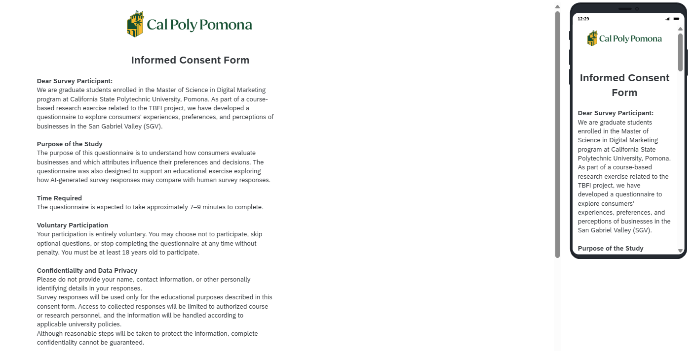

## Submission overview

This report provides access to Group 8’s revised TBFI questionnaire, the Qualtrics survey, and the latest Construct and Measurement (C&M) Table.

## Documents links

| Document | Link |
|------------------------------------|------------------------------------|
| Revised Word or Google Doc questionnaire | [Revised Google Doc questionnaire](https://docs.google.com/document/d/1JQZFPwiwyKLNt7RXEeyV0t4H9QAVUECy4x9OEGfGJAE/edit) |
| Qualtrics questionnaire | [Open survey](https://cpp.az1.qualtrics.com/jfe/form/SV_2ujgUci31v9QF4W) |
| Latest C&M Table | <https://docs.google.com/document/d/1ZI18GTDaXHCRTz3x4cXcZvnghRol7qQ8/edit> |
| Project repository | [Group 8 GitHub repository](https://github.com/gabrielarq1/CEP--Group-8) |

## Revised questionnaire structure

The revised questionnaire follows a funneling approach. It begins with study information and consent, followed by screening questions about age, connection to the San Gabriel Valley, and industry experience. The questionnaire is organized into seven blocks: study information and consent; screening; past behavior and experience; brand perceptions; preferences and decision making; open-ended feedback; and optional demographics and control variables. General questions appear before specific brand ratings, and sensitive demographic questions appear at the end.

Two open-ended questions let participants describe unmet needs and a recent experience in their own words. Optional demographic questions appear at the end and include age, gender, employment, student status, household income, and location. These variables can help us compare customer groups. The rating questions include options such as “Cannot judge” or “Not applicable” where appropriate, so participants can avoid giving an opinion they do not have.
A separate consultant performance assessment addresses AO4 through proposed tasks scored before and after simulator use.It proposes before-and-after tasks covering client intake, research design, synthetic panel fielding, perceptual mapping, and client readout. The final scenario and scoring rubric still need to be confirmed.

## Survey

##